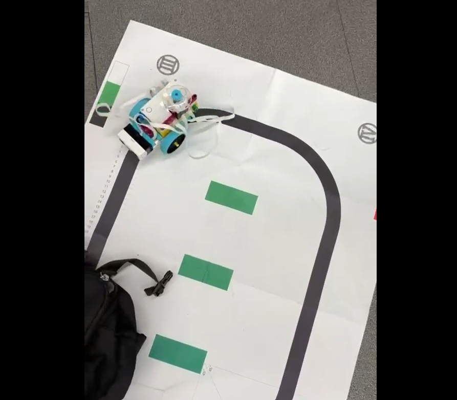

## Robot Gallery / ロボットの写真

### Robot and Track / ロボットと走行コース

# LEGO SPIKE Prime — Line Following Robot

**Sensor-Based Autonomous Navigation & Bluetooth Telemetry**

LEGO Education SPIKE Primeを使用して開発した、ライントレースロボットのプロジェクトです。

Pythonによるモーター制御、カラーセンサーを利用したライン追従、ジャイロセンサーによる姿勢情報の取得、Bluetooth通信によるPCとのデータ連携を実装しました。

---

## Demo / デモ動画

[Watch Robot Demonstration (lego.mp4)](lego.mp4)

黒いラインが描かれたコースをロボットが走行し、カーブを曲がる様子を確認できます。

## Features / 主な機能

### 1. Line Following / ライントレース

カラーセンサーの反射光データを取得し、設定したしきい値に基づいて左右のモーターを制御します。

- Color Sensor: Port C
- Motor Pair: Ports E / F
- Reflection Threshold: 63
- Steering adjustment based on sensor readings

### 2. Gyroscope Tracking / ジャイロセンサー

SPIKE PrimeのYaw角を取得し、ロボットの回転状態を記録します。

取得した角度データを使用して、回転量に基づく走行終了判定を行います。

### 3. Bluetooth Communication / Bluetooth通信

Bluetooth Virtual COM Port (BT_VCP) を使用して、PCとロボット間のデータ通信を実装しました。

送信データ：

- 反射光センサーの測定値
- ジャイロセンサーのYaw角
- ステアリング設定履歴

### 4. Feedback Control / フィードバック制御

PCから受信した補正値に基づき、ステアリングパラメータを更新する仕組みを実装しました。

### 5. Start Position Alignment / 開始位置調整

カラーセンサーの反射光を利用して、走行開始時のロボットの向きを調整します。

## Tech Stack / 使用技術

| Category | Technology |
|---|---|
| Programming | Python |
| Hardware | LEGO Education SPIKE Prime |
| Sensor | Color Sensor, Force Sensor, Gyroscope |
| Motor Control | SPIKE Python API |
| Communication | Bluetooth Virtual COM Port |
| Navigation | Threshold-based Line Following |
| Data Collection | Reflection and Yaw Measurements |

## System Workflow / システム構成

1. PCからステアリング補正値を受信
2. カラーセンサーで反射光を測定
3. 測定結果に応じてモーターを制御
4. 走行中に反射光・ジャイロデータを収集
5. 回転量を判定し走行を停止
6. 収集データをBluetooth経由でPCへ送信
7. 新しい補正値を受信して次の走行に反映

## Source Code / ソースコード

- `main.py` — SPIKE Prime制御プログラム（追加予定）
- `プロジェクト 1.llsp` — LEGO SPIKEプロジェクト
- `プロジェクト 2.llsp` — LEGO SPIKEプロジェクト
- `lego.mp4` — ロボットの動作デモ

## What I Learned / 学んだこと

本プロジェクトを通じて、以下の技術を学びました。

- Pythonによるロボットのモーター制御
- センサーデータを利用した走行アルゴリズム
- ジャイロセンサーを利用した姿勢情報の取得
- Bluetoothを利用したハードウェアとPC間の通信
- センサーデータの収集とフィードバックによるパラメータ調整

---

## English Overview

This project implements a line-following robot using LEGO Education SPIKE Prime and Python.

The robot uses a color sensor to measure reflected light and adjust its steering, collects gyroscope yaw measurements, and exchanges telemetry and steering correction data with a computer via Bluetooth.

The project demonstrates embedded Python programming, sensor-based navigation, motor control, data acquisition, and hardware-software integration.
